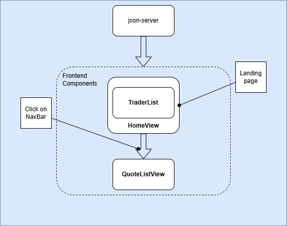

# Vue Trading Application

## Introduction

This project is a trading application built with **Vue.js**, **Tailwind CSS**, and **json-server** as the backend. It allows users to view, add, edit, and delete trader data, as well as view stock quotes. The application has two main parts:

- **Trader Management** - users can add, edit, and delete traders.
- **Quote Display** - users can view real-time stock quotes.

### Key Features:

- **Trader Management** - users can add, delete, and edit traders. Each trader has attributes such as name, email, date of birth, and country.
- **Quote Display** - users can view the latest stock quotes.

### Technologies Used:

- **Frontend**: Vue.js, Tailwind CSS, Axios for HTTP requests
- **Backend**: json-server for a mock REST API
- **Others**: Vue Toastification for notifications, Vue Router for routing, Prime Icons

The app provides an easy-to-use interface for managing trader information and viewing stock quotes.

## Quick Start

To get started with the project, follow the steps below:

1. **Install Node.js and npm**:  
   [Download Node.js](https://nodejs.org/) and install npm.

2. **Install dependencies**:

   - Navigate to the project directory and install the required dependencies:
     ```bash
     npm install
     ```

3. **Run the Backend**:

   - Start the json-server to handle mock data:
     ```bash
     npm run server
     ```

4. **Run the Frontend**:

   - Start the Vue.js application:
     ```bash
     npm run dev
     ```

Once both the backend and frontend are running, you can access the app at `http://localhost:5713`.

## Architecture



## Application Structure

### Backend

The backend uses **json-server** to mock the API. It exposes the following endpoints:

- **GET** `/traders` - Fetch the list of traders.
- **POST** `/traders` - Add a new trader.
- **PUT** `/traders/:id` - Edit an existing trader.
- **DELETE** `/traders/:id` - Delete a trader.

### Frontend

The frontend is built with **Vue.js** and is styled using **Tailwind CSS**. It includes the following views:

- **HomeView**: Displays a list of traders.
- **AddTraderView**: Allows users to add a new trader.
- **EditTraderView**: Allows users to edit an existing trader.
- **QuoteListView**: Displays stock quotes.

### File Structure

- `src/components/`: Contains reusable components.
- `src/views/`: Contains the view components for adding, editing, and listing traders.
- `src/router/index.js`: Contains the Vue Router configuration.

## Architecture

The app follows a client-server architecture where:

- The **Vue frontend** communicates with the **json-server backend** using HTTP requests (Axios).
- The frontend interacts with the mock API to manage trader data (CRUD operations) and fetch stock quotes.

## Test

The application was tested by interacting with both the frontend and backend through the user interface. Tests include:

- Verifying that traders can be added, edited, and deleted correctly.
- Checking that stock quotes are displayed properly.
- Ensuring form validation works when adding or editing trader data.

For testing individual components, Vue's **reactivity system** was used, along with **Axios** for API calls and **Vue Toastification** for displaying success or error messages.

## Improvements

In future versions, the following improvements are planned:

- **Real-time Stock Quote Updates** - implement a real-time stock quote refresh feature using an external API.
- **User Authentication** - add login/logout functionality and role-based access control.
- **Mobile Responsiveness** - enhance the user interface for better mobile responsiveness.
